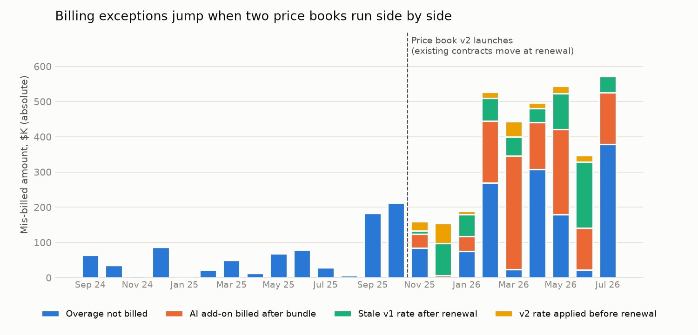
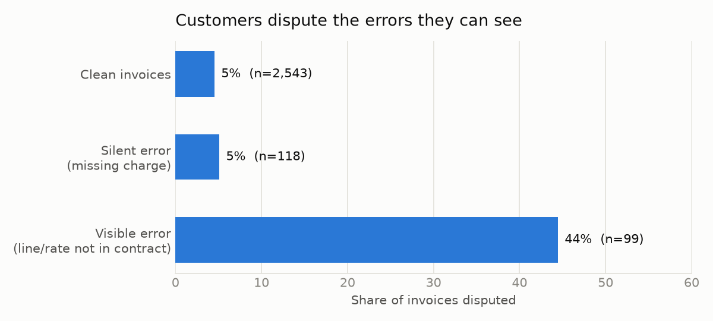
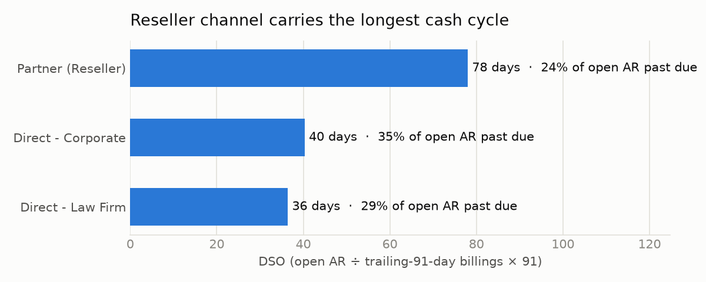

# Pricing-Change Billing Audit: a Usage-Based SaaS Stress Test

When a usage-priced SaaS company changes its price book, the billing system
has to rate two sets of rules at once for about a year while existing
contracts roll to the new pricing at renewal. This project checks whether
invoices still match contracts through that change, and follows what happens
to cash when they don't.

> **This dataset is 100% synthetic.** The vendor, customers, partners, rates
> and volumes are invented. Rates are illustrative, not any company's list
> price. The industry context below comes only from public sources, and the
> "likely challenges" section is my own speculation. It is not a claim
> about any company's internal operations.

## Why this scenario

Legal-data / eDiscovery software is going through this kind of shift right now:

- **Pricing is moving from metered AI add-ons to bundled per-GB pricing.**
  At Relativity Fest (Oct 2025), Relativity said aiR for Review and aiR
  for Privilege would be included in standard RelativityOne pricing in
  2026. aiR for Case Strategy stays a separately priced product. Everlaw
  responded by making some of its AI assistant features free.
  ([PR Newswire](https://www.prnewswire.com/news-releases/relativity-fest-2025-relativity-announces-generative-ai-solutions-for-legal-review-to-be-standard-in-cloud-offering-302578299.html),
  [eDiscovery Today](https://ediscoverytoday.com/2025/10/08/relativity-announces-generative-ai-solutions-to-be-standard-in-cloud-offering/),
  [Above the Law](https://abovethelaw.com/2025/10/relativity-offers-key-ai-products-at-no-extra-charge-but-thats-not-the-most-important-thing/))
- **Usage-based revenue is the industry norm, and it is lumpy.** DISCO,
  the one public pure-play, describes a usage-based model. Committed-minimum
  subscriptions were only 9% of its 2025 revenue, and it announced a further
  change to its commercial framework in 2026.
  ([DISCO FY2025 10-K](https://www.sec.gov/Archives/edgar/data/1625641/000162564126000044/law-20251231.htm))
- **The channel is a big part of the business.** Relativity sells through
  Distributor and Provider partners that resell its SaaS to their own
  clients. ([Relativity partner program](https://www.relativity.com/partners/program-roles-and-benefits/))
- **IPO readiness raises the bar on controls.** Relativity confidentially
  submitted a draft S-1 in March 2026.
  ([Relativity press release](https://www.relativity.com/news-events/press-release-relativity-announces-confidential-submission-of-draft-registration-statement-for-proposed-initial-public-offering/))
  Public-company billing has to survive SOX testing and external audit
  requests. It is no longer enough for it to be mostly right.

### Likely O2C challenges in this environment (speculative)

1. **Rating two price books by renewal date instead of calendar date.**
   Every contract has its own switch-over month. Each one is a chance for a
   stale rate, a leftover AI line, or an early switch.
2. **Variable invoices get disputed more.** Usage-based invoices change
   every month, so customers check them more closely. Accuracy is the first
   defense against disputes.
3. **Reseller cash cycles.** Partners often pay after their own clients
   pay them, which stretches DSO and concentrates exposure in a few large
   balances.
4. **Launching products that billing can support.** Every new bundle
   (included AI, add-ons like Case Strategy, non-litigation use cases) needs
   a billing configuration, revenue treatment and controls in place before
   launch.
5. **Audit-ready evidence.** "Invoice ties to contract × usage" has to be a
   repeatable, documented test, not a one-off reconciliation.

## What the project does

1. **`01_generate_synthetic_data.py`** builds 120 accounts across three
   channels (direct corporate, direct law firm, reseller partner). It
   simulates 24 months of lumpy per-GB usage and AI-review volume, then
   produces invoices from a simulated billing system that switches price
   books on 2025-11-01, with contracts moving at each renewal. The billing
   system makes four realistic kinds of transition mistake. Those error flags
   are **dropped before saving**, so the audit has no answer key.
2. **`02_analysis.py`** re-rates every invoice independently from two
   sources the billing team doesn't control, the **contract terms** and the
   **metered usage feed**. It compares each invoice line by line, sorts the
   exceptions into credit-memo or rebill, runs SOX-style control tests, and
   connects billing accuracy to disputes and DSO.

## Findings (on the synthetic dataset)

### Exceptions rise from 2.6% to 16.1% of invoices after the price change



Across 2,760 invoices ($171M billed), the re-rating audit found **217
exceptions**:

| Exception | Invoices | Net $ impact | Fix |
|---|---:|---:|---|
| Overage not billed | 73 | −$2.19M | Supplemental invoice |
| AI add-on billed after bundle | 65 | +$1.23M | Credit memo |
| Stale v1 rate after renewal | 45 | −$0.66M | Rebill |
| v2 rate applied before renewal | 34 | −$0.08M | Rebill / contract check |

That comes to **~$3.0M of under-billing (revenue leakage)** and **~$1.3M
of over-billing (credit exposure)**. The full ranked worklist is in
[`data/billing_exceptions.csv`](data/billing_exceptions.csv).

### Customers dispute the errors they can see



When a line or rate appears that isn't in the customer's contract, **~44%**
of those invoices are disputed, against ~5% for clean invoices. Missing
charges don't cause disputes because nobody notices them, so they turn into
leakage. A collections team sees only the first kind, which makes the
second kind the reason to run an independent re-rating check.

### The reseller channel has the longest cash cycle



In this simulation, partner accounts carry **~78 days DSO** against ~36–40
for direct. They also hold most of the open AR, because a few large
partners aggregate many end clients.

### Control tests (SOX-style)

| Control test | Population | Exceptions | Pass rate |
|---|---:|---:|---:|
| Hosting rate on invoice matches contracted price book | 2,760 | 79 | 97.1% |
| No AI add-on billed on bundled (v2) contracts | 449 | 65 | 85.5% |
| All metered overage above commit is invoiced | 1,692 | 73 | 95.7% |
| Invoice total ties to re-rated contract × usage (±$1) | 2,760 | 217 | 92.1% |
| …same test, post-price-change months only | 1,080 | 174 | 83.9% |

## What I'd do with this in a real O2C seat

- **Before a pricing launch:** run this re-rating as a pre-bill check on
  every invoice in a transition cohort (accounts renewing that month) and
  hold any exception before the invoice goes out.
- **Make the control permanent:** schedule the "invoice ties to contract ×
  usage" test monthly. Its output is the audit evidence.
- **Route the fixes:** send credit memos to billing with an approval
  trail. Send under-billing through rebill and customer communication
  owned by account management, not a surprise invoice.
- **Treat partners separately:** track partner DSO on its own, and
  consider consolidated partner statements and terms that match when
  partners get paid by their own clients.

## How this maps to a Zuora + Salesforce stack

The simulation is tool-agnostic. In a Zuora Billing / Salesforce CPQ
environment, the same logic maps like this:

| In this project | In Zuora / Salesforce |
|---|---|
| Price book v1 → v2 | Product catalog: new product rate plan (bundled per-GB charge) alongside the legacy plan + AI usage charge |
| Contract moves at renewal | Renewal **amendment** swapping rate plans. The four exception types are what an incomplete amendment looks like |
| Metered usage feed | Usage records uploaded against the usage charge before the bill run |
| Independent re-rating | **Pre-bill-run review**: re-rate the draft bill run from the Salesforce contract + usage file and hold exceptions before posting |
| Credit memo vs. rebill worklist | Zuora credit memos / invoice adjustments with approval workflow; supplemental invoice for missed overage |
| Commit vs. overage | Committed-volume charge + overage (tiered/volume) charge model |

### Control matrix sketch (billing operations)

| ID | Control | Type | Frequency | Evidence |
|---|---|---|---|---|
| BIL-01 | New/amended subscriptions tie to the signed order form (rate plan, price, dates) | Key, manual + report | Per amendment | Order form ↔ subscription comparison, reviewer sign-off |
| BIL-02 | Pre-bill-run re-rating: draft invoices tie to contract × usage within tolerance | Key, automated + review | Each bill run | Exception report (this project's `billing_exceptions.csv`) + disposition |
| BIL-03 | Usage upload completeness: usage records = metered usage from the platform | Key, automated | Each bill run | Record-count and GB reconciliation |
| BIL-04 | Credit memos / adjustments over threshold are approved and reason-coded | Key, manual | Per transaction | Approval log |
| BIL-05 | No legacy (v1) charges billed on migrated (v2) subscriptions | Transition, automated | Monthly during migration | The "no AI add-on on bundled contracts" test above |

### Natural extensions

- **Multi-entity / multi-currency:** add billing entity and invoice
  currency to accounts, rate in local currency, and re-run the tie-out
  per entity with FX at invoice date.
- **Partner statements:** consolidate reseller invoices and track partner
  DSO against partners' own collection timing.
- **AI-assisted triage:** have an LLM draft the exception disposition
  (credit vs. rebill, customer note) from the contract and usage record for
  a human to approve. It speeds up the review without taking the approval
  out of the control.

## Reproducing this analysis

```bash
pip install pandas numpy matplotlib

cd scripts
python 01_generate_synthetic_data.py
python 02_analysis.py
```

Outputs are written to `data/` and `figures/`.

## Related

This builds on the [**AR Aging & Collections Prioritizer**](../ar-collections-prioritizer/),
which covers *who to call first* once an invoice is out. This project covers
the earlier step: *whether the invoice was right in the first place*.
